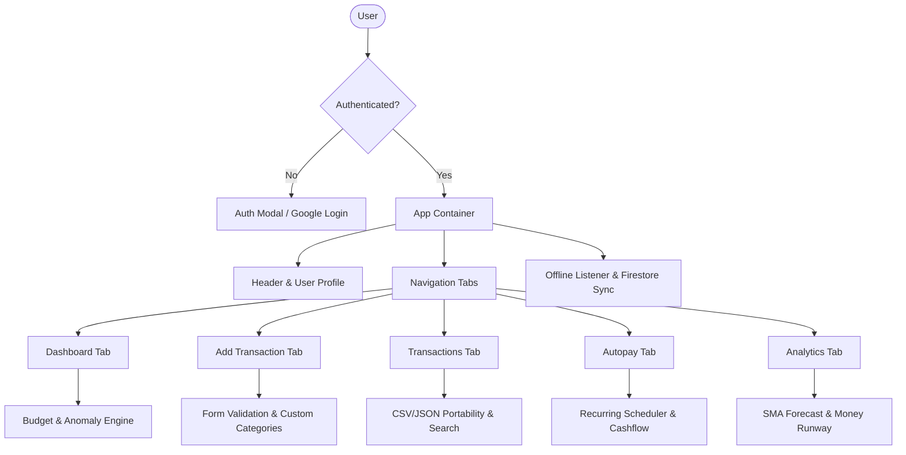

# Product Requirement Document (PRD): Digital Spending Tracker (MoneyTracker)

**Version:** 2.0 (React 19 + TypeScript Port)  
**Status:** Released / In Production  
**Last Updated:** November 2026  
**Target Environment:** Modern Web (Desktop, Tablet, Mobile)

---

## 1. Executive Summary & Product Vision

### 1.1 Executive Summary
**Digital Spending Tracker** (branded as **MoneyTracker**) is a privacy-first, cloud-synchronized personal financial management web application. It empowers individuals to track income and expenses, budget effectively against monthly spending limits, detect unusual or anomalous expenses statistically, schedule and automate recurring commitments (autopay), and project cash flow sustainability using statistical moving average forecasting and money runway models.

### 1.2 Product Vision
To provide personal finance tracking that bridges the gap between simple manual expense logs and heavyweight accounting software. MoneyTracker operates with zero third-party tracking, runs entirely client-side with robust offline sync recovery, and provides actionable predictive intelligence without requiring open banking credentials or exposing financial accounts.

---

## 2. Target Audience & User Personas

| Persona | Description | Core Needs | Key Features Leveraged |
| :--- | :--- | :--- | :--- |
| **P1: Salaried Professional** | Regular monthly salary with recurring commitments (rent, utilities, subscriptions, EMIs). | Visibility into remaining balance, automated monthly recurring flow, budget limit protection. | Dashboard budget progress, Autopay scheduler, Monthly flow indicator. |
| **P2: Freelancer / Variable Earner** | Multiple intermittent income streams and variable daily business expenses. | Forecasting cash burn, knowing how long funds will last, CSV bulk import for tax prep. | Money Runway, Time Series 7-Day SMA forecast, CSV export/import deduplication. |
| **P3: Budget-Conscious Saver** | Strict monthly budget targets seeking to avoid overspending and catch billing anomalies. | Real-time warnings when nearing limits, immediate alerts on statistical spending spikes. | Threshold alert system, Z-Score anomaly detection, Day-of-week spending heatmap. |

---

## 3. Technology Stack & Architectural Principles

### 3.1 Architectural Principles
1. **Zero External UI Libraries**: All UI primitives (dropdowns, calendar pickers, day selectors, modals, toasts) are hand-built with accessible semantic HTML, keyboard trapping, and CSS animations.
2. **Strict Separation of Concerns**:
   - `src/lib/`: Pure business logic, deterministic calculations, and zero React or DOM dependencies with 100% unit test coverage.
   - `src/services/`: Isolated infrastructure layer (Firebase Auth, Cloud Firestore, Network Observers). Components never interact directly with the Firebase SDK.
   - `src/context/`: Declarative state management via React Context and custom hooks without third-party state stores.
   - `src/components/`: One typed component per file, named exports, receiving processed data via context or typed props.
3. **Offline-First Resilience**: Local state reflects optimistic updates immediately; changes are queued and synced to Cloud Firestore when network connectivity is verified.

### 3.2 Technology Matrix
- **Framework**: React 19 (`react`, `react-dom`)
- **Language**: TypeScript 5.9 (Strict Mode, `noImplicitAny`)
- **Build Tool**: Vite (`rolldown-vite` runtime)
- **Styling**: Tailwind CSS v3.4.17 + Design Tokens System (Instrument Sans & Bricolage Grotesque, CSS Custom Properties, SVG Icons, Zero external CSS/font CDNs)
- **Data Visualization**: Chart.js v4.5.1 + `react-chartjs-2` v5.3.1
- **Backend / Authentication**: Firebase Modular SDK v13 (Firebase Auth + Cloud Firestore)
- **Testing**: Vitest v5 + `@testing-library/react` + JSDOM

---

## 4. Detailed Functional Requirements



### Module 1: Authentication & Identity Management
- **FR-1.1 Email/Password Authentication**: User can sign in or sign up using email and password. New accounts are created automatically if credentials do not exist.
- **FR-1.2 Google Sign-In**: One-click authentication via Firebase Google Auth Provider popup.
- **FR-1.3 Password Recovery**: User can trigger a password reset email via Firebase Auth.
- **FR-1.4 Profile Management**: Authenticated users can view registration metadata, provider type, update display names, set or change passwords, and permanently delete their account with cascading data removal.
- **FR-1.5 Error & State Handling**: Inline validation errors with shake animation, loading spinners during async calls, and automatic session restoration.

### Module 2: Dashboard & Overview
- **FR-2.1 Key Metrics Cards**: Displays real-time calculations for:
  - *Total Monthly Income*: Sum of all income transactions in current calendar month.
  - *Total Monthly Expenses*: Sum of all expense transactions in current calendar month.
  - *Current Balance*: Income minus expenses, dynamically formatted in Indian Currency (`₹XX,XXX`) with positive (green) and negative (red) visual indicators.
- **FR-2.2 Budget Goal Monitoring**:
  - Visual progress bar showing percentage of monthly expense limit consumed.
  - Dynamic status styling: Normal (`is-good`), Approaching Limit (`is-warning`), Exceeded Limit (`is-danger`).
  - Inline settings form to update monthly spending limit and threshold percentage (default 80%).
- **FR-2.3 Weekly Activity Visualization**: Bar chart displaying daily income versus expense totals over the last 7 calendar days.
- **FR-2.4 Spending Anomaly Detection Alert**:
  - Real-time banner notifying user if a recent transaction exceeds 2 standard deviations ($Z > 2.0$) above the category historical mean (for categories with $\ge 3$ transactions).
  - One-click *Approve* (marks legitimate and suppresses future alerts) or *Dismiss* (deletes erroneous transaction).
- **FR-2.5 Recent Transactions Feed**: Quick view of the 5 most recent transactions with category badges and deletion actions.

### Module 3: Transaction Management & Data Portability
- **FR-3.1 Transaction Logging**:
  - Fields: Amount (`₹`), Type (Income / Expense), Deduction Date, Category, Payment Method (Cash, Credit Card, Debit Card, UPI, Net Banking, Bank Transfer), and Description.
  - Custom interactive calendar date picker with direct navigation, today shortcut, and clear actions.
  - Custom accessible dropdown selectors with ripple animation and arrow-key keyboard navigation.
  - Ability to create and save custom categories per transaction type.
- **FR-3.2 Search & Multi-Criteria Filtering**:
  - Live full-text search across descriptions, categories, and payment methods.
  - Type filter (*All*, *Income Only*, *Expenses Only*).
  - Month filter dynamically populated from recorded transactions.
  - Multi-attribute sorting: Date (Newest/Oldest), Amount (Highest/Lowest), Category (A-Z).
- **FR-3.3 Pagination**: Smooth 10-item-per-page pagination with accessible Previous/Next navigation and range indicators.
- **FR-3.4 Data Portability**:
  - *CSV Export*: Exports all or filtered transactions adhering to RFC-4180 with proper quote escaping.
  - *JSON Backup*: Complete export of transactions and categories for cold backup.
  - *CSV Import*: Client-side CSV parser supporting standard banking headers (`Date, Type, Category, Amount, Payment Method, Description`). Automatically deduplicates incoming records against existing transactions.

### Module 4: Autopay & Recurring Payment Engine
- **FR-4.1 Recurring Plan Setup**: Users can schedule recurring monthly obligations (subscriptions, utilities, rent, recurring investments).
- **FR-4.2 Deduction Day Picker**: Custom calendar grid allowing selection of days 1 through 31, or a dedicated "Last Day" toggle.
- **FR-4.3 Scheduled Processing**: On application load, the system detects if current date $\ge$ scheduled autopay day for the month. If unprocessed, transactions are generated automatically with `[Autopay]` or `[Recurring Income]` tags.
- **FR-4.4 Monthly Flow Projection**: Summary banner computing net monthly scheduled flow (`+₹Income / -₹Expenses`).
- **FR-4.5 Status Control**: Instant toggle between *Active* and *Paused* states, and permanent deletion with confirmation modal.
- **FR-4.6 Upcoming Agenda**: Visual timeline showing scheduled plans remaining in the active calendar month with countdown days.

### Module 5: Advanced Analytics & Forecasting
- **FR-5.1 Quick Presets & Period Selectors**:
  - One-click time window filters: *This Week*, *This Month*, *Last 30 Days*.
  - Period granularity dropdowns: *Overall*, *Monthly*, *Yearly* with dynamic year/month selector binding.
- **FR-5.2 Daily Expenses Chart**: 30-day temporal bar chart illustrating daily expenditure trends in INR.
- **FR-5.3 Category Breakdown Chart**: Interactive doughnut chart displaying category distributions with percentage allocations and tooltip callouts.
- **FR-5.4 7-Day SMA Time Series Forecast**:
  - Fills temporal gaps with zero-expense baseline days to preserve time-series continuity.
  - Computes a 7-day Simple Moving Average ($SMA_7 = \frac{1}{7}\sum_{i=0}^6 D_{t-i}$).
  - Projects expected daily spending over the next 7 days with confidence score based on coefficient of variation ($CV$).
- **FR-5.5 Money Runway Prediction**: Calculates days until capital depletion ($\text{Days} = \lfloor \frac{\text{Current Balance}}{\text{Average Daily Spend}} \rfloor$), daily burn rate percentage, and estimated depletion date.
- **FR-5.6 Day-of-Week Spending Heatmap**: Bar chart aggregating expenditure by weekday (Monday–Sunday) with color-intensity heat gradients and qualitative pattern insight commentary.

### Module 6: System Modals, Toasts & Resilience
- **FR-6.1 Toast Notification System**: Multi-type toasts (*Success*, *Error*, *Warning*, *Info*) with automated timer dismissal, stacked layout, and manual close.
- **FR-6.2 Accessible Confirmation Dialog**: Centered modal with backdrop click dismissal, `Escape` key handling, and danger/warning action styling.
- **FR-6.3 Offline Sync Recovery**: Detects browser online/offline status, notifies user with system toast, queues unsynced operations, and re-synchronizes with Cloud Firestore immediately upon connection restoration.

---

## 5. Non-Functional Requirements (NFRs)

### 5.1 Performance
- **Initial Load Time**: $< 1.2\text{s}$ over 4G networks; bundle size $< 350\text{kB}$ gzipped.
- **Client-side Calculations**: Pure functions in `src/lib/` must execute in $< 10\text{ms}$ for up to 10,000 transactions.
- **Chart Render Speed**: Chart updates must render in $\le 60\text{fps}$ without UI jank.

### 5.2 Security & Data Privacy
- **Client-Side Data Access**: No API keys exposed in repository; public configuration reads from environment or secure public config.
- **Authentication**: Strict Firebase token verification and HTTPS-only communications.
- **Firestore Rules**: Strict user-level isolation where read/write is authenticated and scoped to `request.auth.uid == userId`.

### 5.3 Usability & Design Fidelity
- **Design System Specification**: Conforms strictly to `docs/redesign/SPEC.md`. Warm editorial palette (`--bg` #FAF7F2, `--accent` #2A4FD6 cobalt, `--ink` #1F1B16, `--income` #2E7D5B), 232px desktop left rail, bottom mobile navigation bar, self-hosted WOFF2 typography, 44px touch targets, and inline accessible SVG icon system (replacing `legacy.css` and Font Awesome).
- **Responsive Layout**: Fluid breakpoints optimized for Mobile ($\le 640\text{px}$), Tablet ($641\text{px} - 1024\text{px}$), and Desktop ($> 1024\text{px}$).

### 5.4 Compatibility
- Modern evergreen browsers: Chrome 110+, Safari 16+, Firefox 115+, Edge 110+.

---

## 6. Data Models & Entity Schemas

### 6.1 Transaction Entity
```typescript
interface Transaction {
  id: string;
  type: 'income' | 'expense';
  amount: number;
  category: string;
  paymentMethod: 'cash' | 'credit_card' | 'debit_card' | 'upi' | 'net_banking' | 'bank_transfer';
  description?: string;
  date: string; // YYYY-MM-DD
  createdAt?: string; // ISO 8601
  isAutopay?: boolean;
  autopayId?: string;
}
```

### 6.2 Autopay Plan Entity
```typescript
interface AutopayPlan {
  id: string;
  name: string;
  amount: number;
  type: 'income' | 'expense';
  category: string;
  day: number; // 1-31 (31 designates 'last day')
  description?: string;
  createdAt?: string;
  lastProcessedMonth?: string; // YYYY-MM
  active?: boolean;
}
```

### 6.3 Budget Goal Entity
```typescript
interface BudgetGoal {
  monthlyExpenseLimit: number;
  thresholdPercent: number; // default: 80
}
```

### 6.4 User Profile Entity
```typescript
interface UserProfile {
  uid: string;
  email: string | null;
  displayName: string | null;
  authMethod: string;
  createdAt: string;
  lastSignIn: string;
  hasPassword?: boolean;
}
```

---

## 7. Quality Assurance & Verification Criteria

| Test Category | Target Suite | Success Benchmark | Status |
| :--- | :--- | :--- | :--- |
| **Unit Testing (Logic)** | `src/test/*.test.ts` | 100% pass on all 9 pure calculation modules | **PASS** (43 tests) |
| **Component Testing (UI)** | `src/test/*.test.tsx` | UI interaction, context wiring, rendering | **PASS** (11 tests) |
| **Type Integrity** | `tsc -b` | 0 TypeScript errors under strict mode | **PASS** |
| **Code Hygiene** | `eslint .` | 0 linting errors or unhandled warnings | **PASS** |
| **Bundle Compilation** | `vite build` | Clean production build with minified chunks | **PASS** |

---

## 8. Future Roadmap & Post-Migration Enhancements

1. **Phase 7 (Multi-Currency Support)**: Option to select primary base currency (USD, EUR, GBP) alongside Indian Rupee (INR).
2. **Phase 8 (Split Transactions)**: Ability to split a single bill across multiple categories.
3. **Phase 9 (PWA & Push Notifications)**: Service worker registration for offline installation and native web push notifications for autopay due dates.
4. **Phase 10 (Receipt Attachment)**: Optional Cloud Storage integration for attaching receipts or invoices to expense entries.
